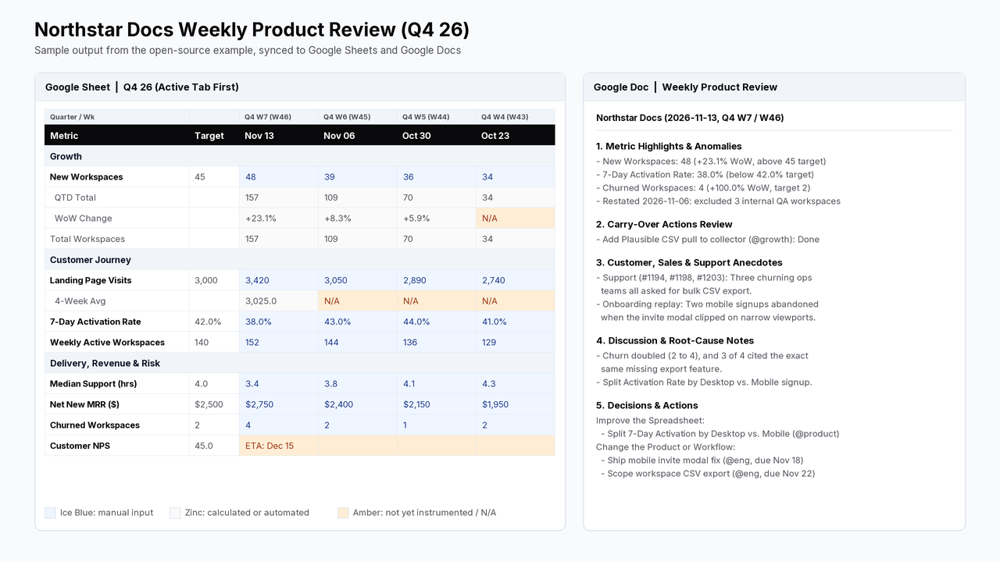

# Weekly Product Review

An agent-native Weekly Review workflow for product builders and teams. Your agent helps pick the 7 to 10 metrics that matter, pulls numbers from your trackers, analytics, and web dashboards, pairs anomalies with real customer anecdotes, and keeps a formatted Google Sheet and review Doc updated in open files any agent can read.

Works with **Codex, Claude Code, Grok, Cursor, and Antigravity** using the open `agentskills.io` format and a zero-dependency Python 3 script.

```bash
npx skills add osbornec/weekly-product-review
```



## Why This Workflow

- **End-to-end agentic workflow, not a static template:** Your agent guides metric discovery, runs collectors across disparate tools, pre-drafts weekly commentary from real evidence, and tracks follow-up actions week over week.
- **Portable across every teammate's agent:** Review memory lives in open, agent-readable files inside `wpr/` rather than one chat thread or proprietary BI tool, so anyone on your team can switch between Codex, Claude Code, Grok, Cursor, or Antigravity without losing context.
- **Scoped Google Sheets and Docs updates:** Stakeholders get a formatted Sheet and running review Doc. Date-keyed connector writes preserve custom tabs, charts, comments and prior reviews; source setup and access are project-specific.
- **Signal over noise, paired with customer anecdotes:** Separates real shifts from weekly jitter using 4-week rolling averages, flags 20%+ moves automatically, and puts raw customer and support feedback beside the numbers so you fix the real product bottleneck.

## Try It Locally in 10 Seconds

Generate the sample B2B SaaS workbook, review brief, and multi-week archive without connecting Google Workspace:

```bash
python scripts/wpr_sync.py build --wpr-dir examples/b2b-saas-wpr --out-dir wpr-output
```

This creates `wpr-output/wpr-workbook.xlsx`, `wpr-output/wpr-review-draft.md`, `wpr-output/wpr-review-brief.md`, `wpr-output/wpr-review-brief.html`, `wpr-output/wpr-review-archive.md`, and `wpr-output/sheets-payload.json`.

The [synthetic creator example](examples/creator-wpr/README.md) adds a read-only collector, explicit capture coverage, preview periods, cumulative article counters and separate content items. For in-place sync, use the [Windows and connector guide](references/connector-sync.md).

## How It Works

Ask your agent:
- *"Set up a Weekly Product Review for this project"* (maps your customer journey, delivery, and money/risk into 7 to 10 team metrics or 10 to 20 leadership metrics, scaffolds local collectors, and creates your Sheet and Doc)
- *"Refresh this week's review numbers"* (runs automated local, export, or browser collectors first, flags 20%+ WoW swings, updates your Sheet and Doc in place, and pre-drafts commentary from observed evidence)
- *"Help me run this week's product review"* (compares moves against 4-week rolling averages, pairs metrics with customer anecdotes, and logs two-track actions to improve the sheet or change the product)
- *"Split activation by mobile vs. desktop"* (evolves metrics, sets quarter-scoped targets, and logs definition changes in `Metric & Target Changelog`)

## Repository Contents

| Path | Purpose |
| :--- | :--- |
| [SKILL.md](SKILL.md) | Agent instructions for Setup, Capture & Refresh, Running Reviews, and Evolution |
| [scripts/wpr_sync.py](scripts/wpr_sync.py) | Zero-dependency Python 3 engine (`validate`, `add-week`, `import-xlsx`, `import-csv`, `build`) |
| [references/](references/) | Methodology, metric discovery menus, Markdown schema, sheet template spec, and sync guide |
| [assets/templates/](assets/templates/) | Starter Markdown templates for `wpr-config.md`, `metrics-data.md`, and `weekly-review.md` |
| [examples/b2b-saas-wpr/](examples/b2b-saas-wpr/) | Sample B2B SaaS Weekly Product Review with 4 weeks of data, restatement log, and review brief |
| [tests/](tests/) | Synthetic regression tests for Markdown preservation, imports, dry runs and interrupted writes |

`add-week`, `import-csv` and `import-xlsx` preserve surrounding Markdown and support `--dry-run` to inspect a diff before writing. No-op imports leave the source file byte-for-byte unchanged. Changed files are replaced atomically.

Run the regression tests with `python -B -m unittest discover -s tests -v`.
See [version 1.1.0 verification](references/release-verification.md) for the tested cases and live synthetic connector checks.

## License

MIT. See [LICENSE](LICENSE).
