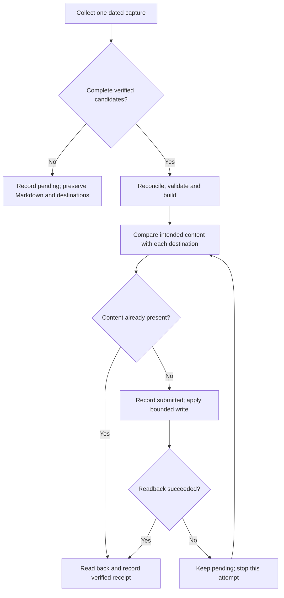

# Recovery and compatibility verification

Checked on 18 November 2026 using invented fixtures. All changes and generated evidence stay local. The development tools in `tests/` are excluded from the installed Skill.

## Measured results

| Check | Result | Limit |
| --- | --- | --- |
| Regression suite | 77 tests pass on CPython 3.8.10 and 3.14.5. | Windows x64; other operating systems and every intermediate Python version were not executed. |
| Installed workflows on Python 3.8 | Nine workflow groups pass using the actual 3.8 interpreter; package hashes and 22 resource checks pass. | The development verifier itself runs on a current Python; `--python` selects the runtime under test. |
| Recovery rehearsal | Seven test methods cover nine injected failure modes, successful repeats and an edited same-date review. | Runs the real collector, reconciler, validator, builder and planner, with development-only orchestration and local JSON destinations. |
| Offline connector contracts | Four tests exercise Drive-style typed `updateCells` and Workspace-style value-range wrapper shapes. | Models the declared request schemas, not authenticated provider execution. |
| One-shot Windows scheduled run | A time trigger invoked the installed workflow from an unrelated working directory. Partial failure, recovery and repeat returned 2, 0, 0. Each modeled destination was written once. The task result was 0 and the task was removed. | Signed-in Windows session with local synthetic destinations. |

The Python 3.8 runtime came from the [official Windows embeddable package](https://www.python.org/downloads/release/python-3810/). Its published archive checksum matched and Windows validated the Python Software Foundation executable signature. It was unpacked into an ignored local folder without registering another system interpreter. Python 3.8 is a legacy compatibility target; use a maintained Python version for normal work.

## Recovery scenarios



- Unavailable and stale collection preserve all existing source bytes and create no destination writes. A failed recapture after success also preserves verified history.
- Sheet failure, Doc failure and injected Doc revision conflict leave the other destination's verified result intact. Recovery targets only missing or changed content for the same reporting date.
- Failed Sheet or Doc readback does not create a verified receipt. Recovery reads the committed content and does not repeat the write.
- A real child-process exit after either modeled destination commit, before checkpoint acknowledgement, recovers without duplicate periods or writes.
- Repeated success performs no extra destination writes. An edited dated review updates the matching modeled Doc section without adding another date section.

The rehearsal runner demonstrates the operating procedure in [connector-sync.md](../skills/weekly-product-review/references/connector-sync.md). It is not a production automation installed with the Skill. Local JSON sentinels model prior reviews, custom content, charts, comments and notes; their preservation does not replace a real connector's native readback or rendered-layout checks.

## Reproduce locally

```powershell
python -B -m unittest discover -s tests

# Select an existing runtime for installed workflow verification.
python -B tests/verify_skill_install.py --skills-cli C:/path/to/skills/bin/cli.mjs --python C:/path/to/python.exe --report .local/runtime-verification.json

# First command intentionally returns 2 for pending Doc sync; the second recovers.
python -B tests/recovery_rehearsal.py --workspace .local/synthetic-recovery --failure doc-unavailable
python -B tests/recovery_rehearsal.py --workspace .local/synthetic-recovery

# Runnable task action; use a fresh workspace and only synthetic destinations.
python -B tests/scheduled_rehearsal.py --workspace .local/synthetic-scheduled --skill-root C:/path/to/installed/weekly-product-review
```

The scheduler action must use absolute interpreter, script, Skill and workspace paths. The actual check used one temporary, hidden Windows task with a single time trigger and an unrelated working directory; no recurring task remains. Running the action directly checks the action only, not the scheduler. A synthetic rehearsal exits nonzero while work is pending; a production runner must provide equivalent failure reporting and bounded recovery.

## Connector contract coverage

The local models check numeric zero versus blank, numbers versus numeric-looking text, formulas versus literal labels beginning with `=`, explicit clears, bounded date-column writes, catalog updates, and retention of unrelated cells, notes and validation. A live date-column mismatch stops formula writes until references are reconciled; a row-layout mismatch is rejected by the real planner before either request route runs.

The shapes were checked against the session's declared connector schemas and Google's primary [Sheets updateCells reference](https://developers.google.com/workspace/sheets/api/reference/rest/v4/spreadsheets/request#UpdateCellsRequest). The [Docs revision-control reference](https://developers.google.com/workspace/docs/api/reference/rest/v1/documents/batchUpdate#WriteControl) supports the required-revision and re-read procedure. No live connector or cloud document was changed during these checks.

Separate live synthetic Google checks are recorded in [release-verification.md](release-verification.md).
