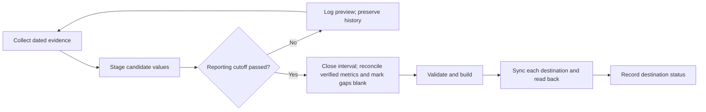

# Collector contract

Use this contract when building a project-specific collector. See [the synthetic creator example](../examples/creator-wpr/README.md) for a runnable implementation.

## Capture and period fields

| Field | Meaning |
| --- | --- |
| `metric_id`, `scope`, `unit` | Stable identity, population measured and unit. Account reach, one item's reach and an article counter are different observations. |
| `period_start_exclusive`, `period_end_inclusive` | Exact reporting boundaries as ISO timestamps with UTC offsets. Never infer a year or timezone from status prose. |
| `time_zone` | Named reporting timezone. Store the actual offset at each boundary, including daylight-saving transitions. |
| `captured_at`, `coverage_through` | When the source was checked and how far its evidence extends. A recent capture does not establish complete coverage. |
| `source`, `source_label` | Exact query, export or dashboard and its displayed label. Preserve its actual window when it differs from the reporting cutoff. |
| `state` | `preview`, `verified`, `verified-zero`, `unavailable` or `stale`. |
| `comparison_group` | A versioned period/definition identifier. Change it when the cutoff, population or counting rule changes; do not compare across groups automatically. |

## State rules

- A numeric zero requires checked coverage for the whole interval. Missing access, incomplete coverage and no returned rows do not establish zero.
- Keep observations from an unfinished interval outside the closed weekly series. New weeks created by `add-week` have `Period State: preview`. After the cutoff, check each metric's evidence and mark the period `closed`: verified values may coexist with blank `unavailable` or `stale` cells. Missing access to one source does not make an independent, fully covered observation provisional. Never close a still-open interval or admit an unverified numeric value merely to display it.
- Legacy week tables without a period-state line are treated as closed for compatibility. Migrate genuinely provisional historical rows explicitly.
- Cell statuses `preview`, `unavailable` and `stale` do not contribute to calculations. `verified-zero` requires numeric zero. Keep the collection origin (`manual` or `automated`) in the source record.
- Stage candidate values without overwriting verified history. A failed recapture changes the capture log, not a previously verified weekly value. Corrections need a dated restatement and supporting evidence.
- For cumulative counters, calculate a difference only between comparable snapshots for the same item. A missing baseline is unavailable. A decrease requires investigation rather than an invented negative growth figure.
- Keep typed item rows separately: original post, article promotion and repost. Weekly item impressions and lifetime profile activity need distinct labels and windows. Item-level totals may overlap and must not replace an account-wide count.
- Record historical baselines with their own windows and source definitions. Never insert nonmatching historical windows into the Friday series merely to obtain four observations.

## Retry and close workflow

- Browser sign-out, unavailable connectors and stale exports: log the source failure and last successful capture; leave unverified values blank.
- Retry the same period and destination identifiers. Do not add another weekly row or duplicate a dated review.
- Stop an individual run after one attempted refresh per failing source. Report what is pending and retry when access is restored; do not retry indefinitely or request broader permissions automatically.
- Track collection, Markdown reconciliation, Sheet sync and Doc sync independently. A successful Sheet update does not establish a successful Doc update.
- Candidate `state: verified` is a collection state, not a Markdown cell status. After verification, reconcile a nonzero automated value using cell status `automated`; use `verified-zero` for a verified zero. Keep the source evidence and collection state in the capture record.
- Persist project-local checkpoints and destination receipts as described in [partial completion](connector-sync.md#partial-completion). A failed readback stays pending; on a later run, read before resubmitting an uncertain write. Revalidate receipts when intended content changes.
