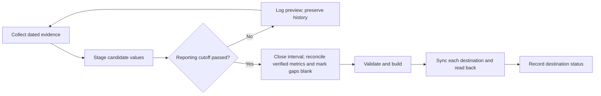

# Collector contract

Use this contract when building a project-specific collector. See [the synthetic creator example](../examples/creator-wpr/README.md) for a runnable implementation.

## Capture and period fields

| Field | Meaning |
| --- | --- |
| `metric_id`, `scope`, `unit` | Stable identity, population measured and unit. Account reach, one item's reach and an article counter are different observations. |
| `period_start_exclusive`, `period_end_inclusive` | Exact reporting boundaries as ISO timestamps with UTC offsets. Never infer a year or timezone from status prose. |
| `time_zone` | Named reporting timezone. Store the actual offset at each boundary, including daylight-saving transitions. |
| `captured_at`, `coverage_through` | When the source was checked and how far its evidence extends. A recent capture does not establish complete coverage. |
| `source`, `source_label` | Exact query, export or dashboard and its displayed label. Preserve its actual window when it differs from the reporting cutoff. |
| `state` | `preview`, `verified`, `verified-zero`, `unavailable` or `stale`. |
| `comparison_group` | A versioned period/definition identifier. Change it when the cutoff, population or counting rule changes; do not compare across groups automatically. |

## State rules

- A numeric zero requires checked coverage for the whole interval. Missing access, incomplete coverage and no returned rows do not establish zero.
- Show a partial observation in the usual scorecard cell as preview text. A count of zero within partial coverage is `0 so far`. Record the source window and capture time. At close, list any missing sources and publish verified values independently. For example, a warehouse review can close with 32 verified shipments and zero verified returns, while a stale carrier feed and a cumulative counter without a comparable baseline stay blank.
- Keep observations from an unfinished interval outside the closed weekly series. New weeks created by `add-week` have `Period State: preview`. After the cutoff, check each metric's evidence and mark the period `closed`: verified values may coexist with blank `unavailable` or `stale` cells. Missing access to one source does not make an independent, fully covered observation provisional. Never close a still-open interval or admit an unverified numeric value merely to display it.
- Legacy week tables without a period-state line are treated as closed for compatibility. Migrate genuinely provisional historical rows explicitly.
- Cell statuses `preview`, `unavailable` and `stale` do not contribute to calculations. `verified-zero` requires numeric zero. Keep the collection origin (`manual` or `automated`) in the source record.
- Stage candidate values without overwriting verified history. A failed recapture changes the capture log, not a previously verified weekly value. Corrections need a dated restatement and supporting evidence.
- For cumulative counters, calculate a difference only between comparable snapshots for the same item. A missing baseline is unavailable. A decrease requires investigation rather than an invented negative growth figure.
- Keep typed item rows separately: original post, article promotion and repost. Weekly item impressions and lifetime profile activity need distinct labels and windows. Item-level totals may overlap and must not replace an account-wide count.
- Record historical baselines with their own windows and source definitions. Never insert nonmatching historical windows into the Friday series merely to obtain four observations.

## Authenticated workbook downloads

Use the signed-in browser profile and the project's configured download directory. Read back the account, source date domain and exact selected range before Export and any confirmation click. Record an offset-aware attempt start, expected filename and existing candidates. Confirm the profile saves to the configured folder. If a native Save dialog appears and the agent cannot reach it, ask the user to save there or adjust that profile's download setting, then check the same attempt before starting another.

| State | Evidence |
| --- | --- |
| `requested` | Export was requested. A click or browser event alone establishes no file. |
| `waiting-for-save` | A native Save prompt requires action. Keep accepted data and report the pending step. |
| `saved` | A completed XLSX arrived during the attempt. Accept duplicate-name suffixes. Check freshness, archive integrity, expected account, declared range and actual rows. Record the actual saved time and SHA-256. |
| `imported` | Reconciliation staged or persisted accepted days, unresolved differences and a receipt. |
| `verified` | Readback confirmed the intended ledger, receipt and coverage. Record the counts and any pending revisions. |

Check disk after an event timeout. Reject older same-name files, partial or changing workbooks, wrong accounts and missing or unexpected dates. If different eligible downloads could belong to the same attempt, resolve which one is correct before importing. Use synthetic XLSX files to test these rules. If a project runs an attended trial or a scheduled invocation, record the result for each route separately.

## Daily exports and weekly rollup

The [synthetic workbook adapter](../examples/creator-wpr/workbook_exports.py) reads exact date rows, text numbers, a range headline and an optional range-unique count. It stages reconciliation without writing the ledger. The project owns persistence and verification.

- Request a configured overlap, such as the last 14 complete UTC days. For a backfill export that includes the open UTC day, record and exclude it. Roll up seven complete UTC dates using the configured review calendar's bound. An unresolved or missing day leaves a gap for its affected metric; verified zeros still count.
- Replaying the same file hash adds zero rows. Compare overlapping dates by account and metric. Keep accepted history on a difference, hold that metric-day out of the rollup and log the proposed value. Require a distinct corroborating capture and a restatement reason before changing the accepted value.
- Keep daily additive series, unique counts for a selected range and lifetime counters separate. Negative export trend engagements can be valid. Dashboard social engagements use their own series and exact windows. When the dashboard and export both report impressions for the same account and completed dates, compare those impressions as a cross-check.
- Keep native profile windows and their source totals in their own date domain. A displayed range total can differ from the sum of plotted daily data. Local events use their configured offset-aware cutoff. The creator collector's optional `source_windows` maps a metric ID to its expected bounds and timezone separately from the overall review cutoff. Preserve the actual windows and observation times for all three sources.

## Worked partial close and source windows

The [partial-close fixture](../examples/creator-wpr/capture.partial-close.example.json) closes the interval with mixed source coverage. Reconcile each source independently. Copy actual capture time and coverage into the matching metric row and name source gaps for the week.

| Metric | Close result | Capture and coverage |
| --- | --- | --- |
| Weekly Account Reach | 250 verified | 5 Feb 17:06 +01:00, covers cutoff at 17:00 |
| Outcomes Accepted | 0 verified | 5 Feb 17:10 +01:00, covers cutoff at 17:00 |
| Weekly Account Visitors | Blank, stale source | Checked 5 Feb 17:08 +01:00, coverage stops 4 Feb at 17:00 |
| Article Views Added | Blank, missing comparable baseline | Checked 5 Feb 17:10 +01:00. Closing counter is 118 at 17:00 |

The same fixture keeps separate item observations even when the source label is `Impressions`. The rolling-seven-day dashboard reports 214 at 17:03 and 218 at 17:09 with a partial final day. The detail view reports 225 since publication at 17:04. Retain each read's label, source, scope, window and capture time. Treat the changed count as a later observation of that window. Keep account profile viewers separate from post-attributed viewers. The collector returns these observations as evidence apart from the weekly candidates.

## Item identity and dated events

- Keep a publication inventory separate from analytics retention. Give the article and its promotional post distinct IDs and link them with a relationship. Resolve each source alias with independent evidence, such as the rendered link or matching archive entry. Hold ambiguous aliases for review.
- An optional structured observation log linked from Markdown can store item ID, metric ID, source, displayed label, scope, exact window, capture time, value and verification state. Keep missing metrics absent or blank with their reason. Later captures are separate observations. Replaying the same capture adds zero rows.
- For a ranked backfill, verify the selected dates and sort metric. If an accessibility label omits a value, use rendered text. Check any additive ranked subset against the same-window account total.
- Keep per-channel evidence and log the source's timestamp precision. Apply the project's explicit cutoff-minute rule. An unresolved cutoff timestamp stays pending. A confirmed booking belongs to its first confirmed date and stable booking ID. Attendance belongs to its own date and may fall in another week. If restating a booking, reconcile both affected weeks and retain attendance context.
- An explicit article reply and an inbound thread that predates a share have different attribution. An embedded share can omit the archive URL. Check the rendered message for the actual linked item and retain that evidence before assigning credit.

## Retry and close workflow

- Browser sign-out, unavailable connectors and stale exports: log the source failure and last successful capture; leave unverified values blank.
- Retry the same period and destination identifiers. Do not add another weekly row or duplicate a dated review.
- Stop an individual run after one attempted refresh per failing source. Report what is pending and retry when access is restored; do not retry indefinitely or request broader permissions automatically.
- Track collection, Markdown reconciliation, Sheet sync and Doc sync independently. A successful Sheet update does not establish a successful Doc update.
- Candidate `state: verified` is a collection state, not a Markdown cell status. After verification, reconcile a nonzero automated value using cell status `automated`; use `verified-zero` for a verified zero. Keep the source evidence and collection state in the capture record.
- Persist project-local checkpoints and destination receipts as described in [partial completion](connector-sync.md#partial-completion). A failed readback stays pending; on a later run, read before resubmitting an uncertain write. Revalidate receipts when intended content changes.
